# Alan Bernardo

**Desenvolvedor de Software | Tecnologia da Informação**

<!-- Substitua os dois endereços abaixo pelos seus contatos antes de publicar. -->

  
  

## Sobre mim

<picture>
  <source media="(prefers-color-scheme: light)" srcset="assets/sobre-mim-light.svg" />
  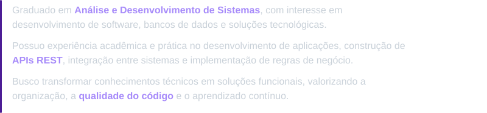
</picture>

## Tecnologias e ferramentas

### Linguagens de programação

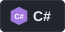  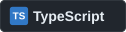 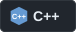

### Desenvolvimento

  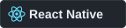  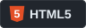

### Banco de dados

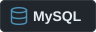 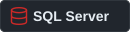

### Ferramentas

   

## Projetos em destaque

<!-- Link do repositório acadêmico original; substitua pelo seu repositório pessoal, se preferir. -->

## Áreas de interesse

        

## Formação acadêmica

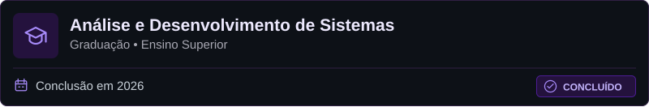

## Certificados e certificações

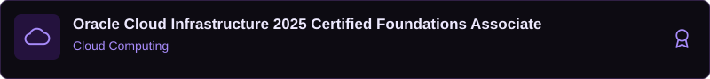

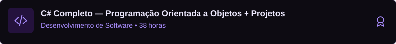

Em constante aprendizado e evolução profissional.

